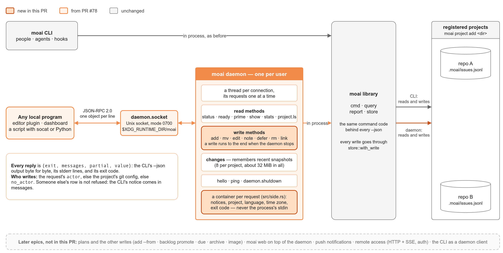
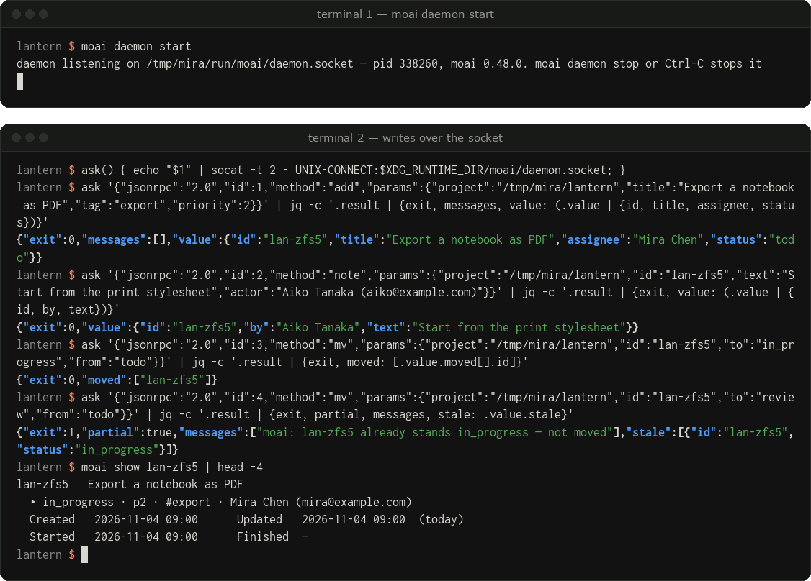
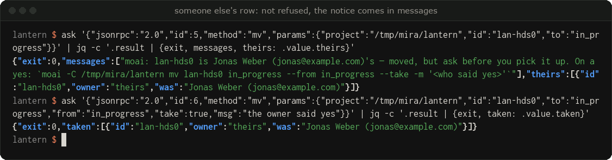
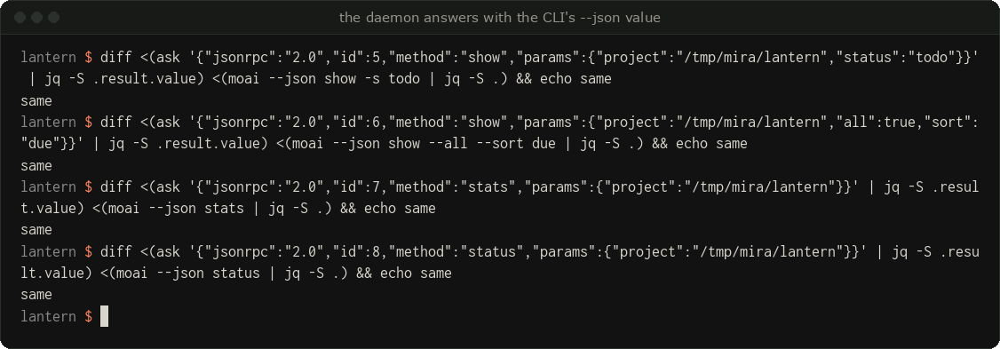
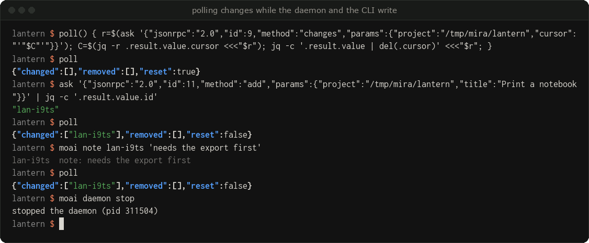

## Summary

This PR adds **write methods** to `moai daemon`: `add`, `mv`, `edit`, `note`, `defer`, `rm` and `link` over the same JSON-RPC 2.0 socket as the read API of PR #78. A write runs the CLI's own command code in process, under the same tracker lock, through `store::with_write`. **The CLI is unchanged** for a person at a terminal: it still reads and writes `.moai` directly, and its output is byte for byte what it was.

It is step 3 of the daemon plan (library → read API → **write API** → plugins). It sits on `milestone/moai-w3sx`, where PR #78 went in, so only this epic's commits show here. It is a draft because whether it joins v0.52.0 or waits is yours to decide: to make it wait, change the base to `develop` once #81 is in.

## What a client gets

- Seven write methods. Params are named after the CLI's long flags (`if_start` for `--if-start`); the arguments with no flag are `id`, `to` (the column for `mv`) and `text` (the note). `add` makes epics, milestones and backlog items with `kind`. Unknown keys are refused with `-32602`, as for reads.
- **Text is text.** `"-"` in `title`, `body`, `msg` or `text` is a dash, not "read stdin": a request has no stdin.
- **The envelope gains `exit`**: `{exit, messages, partial, value}` for every method, reads too. `exit` is the CLI's exit code — a `mv` whose `from` lost a race carries the row under `value.stale`, `partial: true` and `exit: 1`.
- **`value` is the CLI's `--json` bytes**, keys in the CLI's order. PR #78 parsed them into `serde_json::Value`, which sorted keys; you no longer need `jq -S` to compare with `moai --json`.
- **Who writes**: the request's `actor`, else the project's git config, else `-32000` with `data.code` `no_actor`. The daemon's own `MOAI_ACTOR` and `MOAI_HERE` are not read for a request.
- **Someone else's row is not refused.** A `mv` into a started column of a row held by someone else or nobody goes through, as it does at a terminal; the CLI's one-line notice comes in `messages`, and `take: true` is `--take`. Hook rule 5 does not stand on the API — `docs/daemon.md` says so in those words.
- **Stopping**: the daemon removes its socket file and stops accepting first, then lets running requests finish — **writes to the end**, reads up to 5 s. A request that arrives while it stops gets `-32000` `stopping` and does not run. A second `moai daemon stop` during that time waits instead of saying "not a daemon". SIGTERM and SIGINT (`moai-ou5y.gfs`) take the same path, so `systemctl stop` does not cut a write; a second signal still ends the process at once (`docs/daemon.md` lists what can still cut a write).

## See it run

A real run of this branch's release binary (at `00af08e8`; the commits after it do not change these screens) in a demo repository. Nothing was edited afterwards; the scripts that made the pictures are on the media branch (see Checks).

**Write.** `add`, a `note` by another `actor`, a `mv`, then a `mv` whose `from` names a column the row has left: `exit` 1, the CLI's notice in `messages`, the row under `stale`. The CLI then reads the row the daemon wrote.

**Someone else's row.** Not refused: the notice is in `messages` and `value.theirs` names the row. `take: true` takes it over and the CLI's `Taken-over:` note is written.

**Same bytes as the CLI.** `value` against `moai --json` without sorting keys.

**Poll while both write.** A row added through the daemon and a note added by the CLI both come back from `changes`.

## Design decisions

| Decision | Why |
|---|---|
| Writes run the CLI's command functions in process (`cmd::request::write`), not a second write path. | `issues.jsonl` changes only through `store::with_write` (CLAUDE.md). The lock, the re-read inside the lock, temp+rename and the journal are the same code. |
| Everything process-wide a write touches moves into the request container (`src/side.rs`) while one is hung: stdin, stderr notices, the argv re-scan, the chosen exit code, the end-of-run notices, the pick-up record, `MOAI_HERE`. One predicate, `side::hung()`, asks "am I inside a request?". `MOAI_ACTOR` keeps your `Side::ignore_env_actor` (`moai-wbdh.sbd`), which now covers writes too. | A daemon serves many requests and threads; one request's state must not leak into another's, and the environment of whoever started the daemon says nothing about who sent the request. The CLI never hangs a container, so it takes the old path. |
| `value` carries the CLI's bytes (`RawValue`). | When the CLI becomes a daemon client (the end state in CLAUDE.md), the `--json` a person sees must not change key order. |
| Writes run to the end on stop and on a signal; reads keep the 5 s drain. | A cut write can lose a journal line or leave a temp file. Waiting forever for everything would let a request with no time limit hold `stop` forever. |
| Timestamps are taken after the lock is held (note, rm, defer, link, add, `wiki learn`, the explorer's `SPC n`). | A write that waited for another one stamped the earlier time into the journal and the snapshot. This is the one change a CLI user can see (a more accurate time); it is a `Fixed` entry. |
| No new dependency. | std threads, as in PR #78. The release binary is 15,208,056 bytes at the head (budget 20 MB). Built side by side in one directory at `00af08e8`, it was 256 KB over `milestone/moai-w3sx` (15,348,896 against 15,086,848). That directory gives about 140 KB more than the worktree's `target/`; I did not look into why. |

## How we kept the CLI the same

- Existing tests pass, and the new ones join them: 2,690 unit, 979 CLI, 33 daemon, and the rest. `tests/cli.rs` only gains one test (106 lines added, none removed); in `tests/daemon.rs` three existing lines change (helpers, and the read parity test of PR #78 now also compares `value` bytes and `exit`).
- CLI files touched: `src/cmd/{add,mv,edit,defer,rm,backlog,note,link,mod,hook}.rs`, `src/store.rs`, `src/lib.rs`, `src/model.rs`, `src/side.rs`, `src/tui/mod.rs`, `src/cli.rs` (one `pub(crate)` and a constant) — every change takes effect only when a request container is hung, except the timestamp fix and `eprintln!` → `tell` (a closed stderr no longer panics; also a `Fixed` entry).
- `scripts/bindiff.py`, this branch's head against `milestone/moai-w3sx` (`3530b9ce`): 524 cases × 2 languages, 1,049 comparisons, 0 differences. `scripts/bindiff_fuzz.py` (seed 1793827366, at `00af08e8`; after it only `read_line`, comments, docs and a test change): 20,000 random commands, 64 differences — every one the pid on the first line of `moai daemon start`, which differs between any two runs (backlog `moai-wstg` will mask it). Cases that stopped on `Text file busy` in the tool show no difference when rerun alone.
- `the_write_methods_write_what_the_cli_writes`: 47 cases over all seven methods. Each runs through the CLI and through the daemon from the same starting tracker and compares the `issues.jsonl` and journal bytes, `value` bytes against stdout, `messages` against stderr, `exit` against the exit code, and for failures the code and message.
- The command sweep (`every_cli_command_is_served_or_listed_as_not_served`) now lists the seven as served. Plans (`add --from`, `backlog promote`), `due`, `archive`, `image`, `init` and the `project add|rm|color` writes stay "not served" with a reason.

## Concurrency tests

- 6 daemon connections and 4 CLI processes write 100 `add`s and `note`s to one tracker at once: every row and note is there exactly once. With the lock skipped on purpose, 18 of 50 rows survived — the test catches it.
- A write held past the 5 s lock timeout fails with `locked`, the same as the CLI, and writes nothing.
- A real `note` waiting on the lock when `daemon.shutdown` arrives still finishes and answers; a new write on another open connection gets `stopping` and is not written. The same test runs with SIGTERM in place of `daemon.shutdown`.

## Review

The epic-end review ran at `xhigh` (`/code-review xhigh --fix`, ten angles) over this PR's commits only and found 12 issues. Nine were taken in, each in its own `fix:`/`refactor:`/`test:` commit (a second `daemon stop` during a drain, the daemon's `MOAI_HERE`, a refusal line that could be cut, a timing test with too little room under load, one `side::hung()` and one comma-list rule instead of copies, and docs). Two are parked follow-ups (a test that compares the hand-copied clap rules of `edit` with clap; `WriteRequest` repeating `Request`'s fields), and one was left with its reason: a non-JSON output line of a write would turn a done write into an error, but the parity test compares `value` bytes for every write method, so such a line is caught before release. That review predates the merge of `milestone/moai-w3sx` (`dd318fed`), so the merge resolution had its own pass at `high` (`moai-3hgm.vjv.yqs`) and found 10 issues; no data loss showed in the tests. Taken in, each in its own commit: a socket read cut by a signal is read again, `KillMode=mixed` in the systemd example, docs and CHANGELOG that did not match the code, stale comments, a test's socket path. Those fixes were not reviewed again. Handed on: **a second signal (also from a wrapper that forwards signals), SIGHUP, and Ctrl-C reaching `git` children can still cut or fail a request.** `issues.jsonl` stays whole and `docs/daemon.md` says so, but closing that needs changes to your signal handler, so I would like to talk it over first (`moai-hwxb`). `changes::poll` looking up the cursor twice is in your `2100213d` and is not a bug (`moai-jczb`). I kept your `Side::ignore_env_actor` although the review suggested dropping it for `side::hung()`.

## Not in this PR (follow-ups)

Plans and the other writes (`add --from`, `backlog promote`, `due apply`, `archive`, `image`); a linked worktree of a registered project is served only when the worktree path is registered too; `moai daemon start` during a long drain can give up before it ends; the clap rules copied by hand for `edit`/`rm`; `moai web` on top of the daemon; push notifications; remote transport (HTTP, TLS, auth); Windows named pipes; the CLI as a daemon client; and the follow-ups #81 lists.

## Checks

- `cargo test`, `cargo clippy --all-targets -- -D warnings`, `cargo fmt --check`: pass on the branch head.
- Release build: 15,208,056 bytes (budget 20 MB).
- `.moai/`: no change on this branch, since CI does not let a PR from a fork change the tracker. The issue ids in the commit subjects (`moai-3hgm` and its members `.whp`, `.uz0`, `.25e`, `.k7s`, `.pp2`, `.pmc`, `.vjv`, the reviews `moai-3hgm.puw` and `moai-3hgm.vjv.yqs`) are not in this repository's tracker; you can read them — bodies, the decisions each worker made alone with their options, and the review's own words — in `.moai/` on `hedone21:tracker-moai-3hgm` (`ecf64e4a`), e.g. `moai -C <that checkout> show moai-3hgm`.
- Pictures: on `hedone21:pr-media-moai-3hgm` (`e8ff25b`), with the scripts that made them and a README on how. That branch shares no history with moai and is not for merging.
- `CHANGELOG.md`: under `[Unreleased]`, the daemon `### Added` entry now names the write methods, and `### Fixed` has the timestamp entry and the wider EPIPE entry. Two of your lines changed in the merge: the SIGTERM entry (`moai-ou5y.gfs`) now says the socket goes first and requests finish after, because that is the order of the merged code; and the same order is in the signal paragraph of `docs/daemon.md`, which also says a second signal can cut a write. The systemd example's description no longer says read-only, and it gains `KillMode=mixed`.

Merge it, do not squash: `moai show` finds commits by the id in their subject.

🤖 Generated with [Claude Code](https://claude.com/claude-code)
